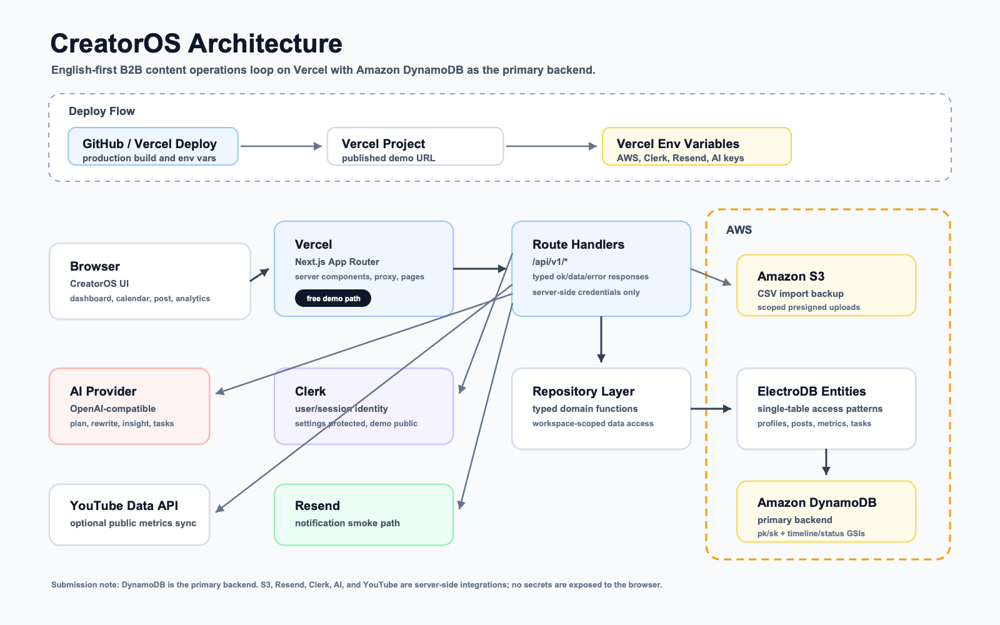

# CreatorOS

**Content operations for cross-platform creator teams.** CreatorOS helps small creator teams plan the next 30 posts, adapt each idea for LinkedIn, X, YouTube, and Rednote, track execution, and turn performance data into the next actions.

Built for **H0: Hack the Zero Stack with Vercel and AWS Databases**.

## Submission Snapshot

| Item | Status |
| --- | --- |
| Track | Track 2: Monetizable B2B app |
| Live demo | https://creatoros-six.vercel.app |
| Frontend deployment | Vercel, Next.js App Router |
| Required AWS database | Amazon DynamoDB as the primary backend |
| Architecture diagram | [SVG](./docs/architecture-diagram.svg) / [PNG](./docs/architecture-diagram.png) |
| AWS database proof | Captured outside the repository for submission |
| Vercel Team ID | Pending; must be recorded outside the repository |
| Demo video | Pending final public video URL |



## What It Does

CreatorOS turns creator work into an operating loop:

```text
onboarding -> monthly plan -> post detail -> platform rewrite -> status workflow -> metrics -> insight
```

The public demo workspace lets judges open the product without signing in and inspect the main path:

1. Start on `/dashboard` and review the 30-day content operating view.
2. Open `/calendar` to see the monthly plan by date and workflow status.
3. Open `/post/post-01` to inspect the draft, platform rewrites, visual previews, hook alternatives, tone sandbox, status workflow, and metrics entry.
4. Open `/analytics` to review trends, import metrics, generate insights, and turn insights into actionable tasks.

## Why It Is Different

- **Content operations, not just AI writing.** The product models the full loop from account DNA to plan, draft, platform adaptation, shipping status, metrics, insights, and next actions.
- **B2B workflow focus.** It is designed for creator teams and agencies that need repeatable content execution, not a one-off chat prompt.
- **DynamoDB is deliberate.** The app uses a workspace-scoped single-table model with timeline and status access patterns rather than treating the database as a generic key-value dump.
- **Judge-safe demo path.** `DEMO#judge` is seeded deterministically and remains usable without private social accounts or judge credentials.
- **No fake OAuth scope.** The MVP intentionally avoids real social OAuth, auto-publishing, billing, complex team permissions, and realtime collaboration.
- **Practical feedback loop.** Metrics can be entered manually, imported from CSV with S3 backup, or optionally synced from public YouTube stats when a server-side API key is configured.

## Key Features

- Account DNA onboarding for niche, audience, platforms, cadence, tone, and goals.
- 30-day content plan across dashboard, calendar, and post detail routes.
- Platform rewrite workflow for LinkedIn, X, YouTube, and Rednote.
- LinkedIn, X, and Rednote visual post mockups.
- Hook Enhancer and Tone Sandbox for fast creative iteration.
- Status workflow: `Idea -> Drafting -> Review -> Scheduled -> Published`.
- Manual metrics entry, CSV metrics import, and optional YouTube public stats sync.
- AI-generated next-cycle insights and actionable task cards.
- Clerk authentication boundary with the public judge demo kept accessible.
- Server-side S3 and Resend integration paths.

## Technical Architecture

CreatorOS is a Next.js application deployed on Vercel. Server route handlers call a repository layer, which uses ElectroDB entities over a single DynamoDB table.

The DynamoDB design is centered on content operations access patterns:

- `Profile`, `MonthlyPlan`, `Post`, `PlatformVariant`, `DraftVersion`, `PostMetric`, `Insight`, `CreatorTask`, and `AiSettings` items share one table.
- Primary keys scope data by workspace, separating `DEMO#judge` from authenticated Clerk users.
- GSI1 supports monthly timeline and metrics reads.
- GSI2 supports workflow status and platform-oriented reads.
- Runtime product reads use targeted `GetItem`, `Query`, `PutItem`, and `UpdateItem` patterns.
- Status-changing writes use version or timestamp checks where practical to avoid silent overwrite.

Server-side integrations:

- **Amazon DynamoDB**: primary backend and submission database.
- **Amazon S3**: CSV import backup and scoped asset upload path.
- **Clerk**: user/session identity and protected settings.
- **Resend**: notification smoke path.
- **OpenAI-compatible provider**: plan, rewrite, insight, and task generation with validation before persistence.
- **YouTube Data API v3**: optional no-auth public stats sync, server-side only.

## H0 Requirement Coverage

| H0 requirement | CreatorOS coverage |
| --- | --- |
| Full-stack app | Next.js App Router frontend plus route handlers, repository layer, DynamoDB persistence, S3, Clerk, Resend, and AI services |
| Required AWS database as primary backend | Amazon DynamoDB single-table model via ElectroDB |
| Frontend deployed on Vercel or v0.app | Production Vercel URL: https://creatoros-six.vercel.app |
| Text description of features | This README and [submission pack](./docs/submission-pack.md) |
| Architecture diagram | [docs/architecture-diagram.png](./docs/architecture-diagram.png) |
| AWS database proof screenshot | Kept outside the repo to avoid private console details |
| Vercel Team ID | Kept outside the repo for Devpost submission |
| Demo video under 3 minutes | Script drafted in [docs/submission-pack.md](./docs/submission-pack.md); final public URL pending |
| Free judge access | Public demo workspace works without sign-in |

## Verification Status

Latest verified checks:

```bash
pnpm lint
pnpm typecheck
pnpm build
git diff --check
CREATOROS_BASE_URL=http://localhost:3120 pnpm smoke:main-path
CREATOROS_BASE_URL=https://creatoros-six.vercel.app pnpm smoke:production
pnpm exec node scripts/seed-demo-workspace.mjs
```

Production smoke passed for pages, core APIs, platform rewrite, status update, manual metrics, insights, actionable tasks, and Clerk settings protection. YouTube live sync is skipped in production until `GOOGLE_PUBLIC_API_KEY` is configured.

## Run Locally

Use `pnpm`; do not mix package managers.

```bash
pnpm install
pnpm dev
```

For a persisted DynamoDB-backed run, copy `.env.example` to `.env.local` and configure the required server-side environment variables. Do not commit real secrets.

To run the judge-path smoke check against a local server:

```bash
CREATOROS_BASE_URL=http://localhost:3000 pnpm smoke:main-path
```

## Project Docs

- [Docs index](./docs/README.md)
- [Submission pack](./docs/submission-pack.md)
- [Technical architecture](./docs/technical-architecture.md)
- [DynamoDB implementation plan](./docs/dynamodb-plan.md)
- [Runtime setup](./docs/runtime-setup.md)
- [TODO checklist](./docs/todolist.md)

## Scope Guard

CreatorOS intentionally does not include real social platform OAuth, auto-publishing, billing, complex team permissions, or realtime collaboration in the H0 MVP. Those are deferred so the submitted product can focus on a complete, reliable, judge-friendly content operations loop.
