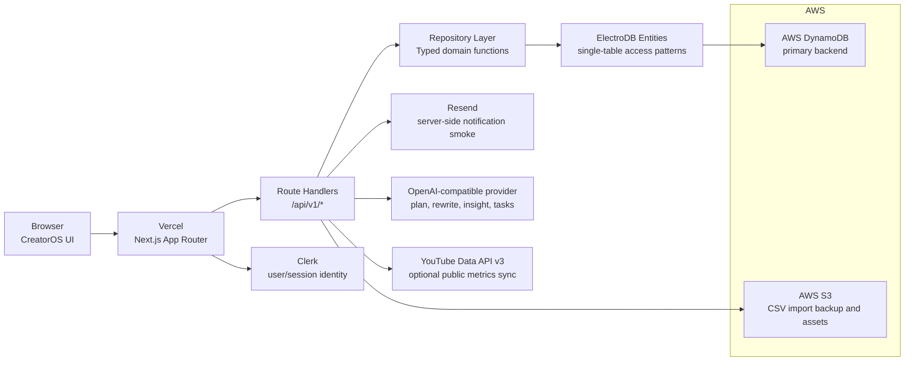

# CreatorOS Submission Pack

Last updated: 2026-06-12

This is the first submission-facing draft for H0. It should stay public-safe: do not add secrets, private account details, Vercel Team ID, storage screenshots, real user data, or private sample accounts.

## Official Requirements Snapshot

Verified on 2026-06-12:

- Submission deadline: June 29, 2026 at 5:00 PM PDT.
- The project must use one required AWS database as the primary backend and deploy the frontend on Vercel or v0.app.
- The submission needs a text description, a public demo video under 3 minutes, the AWS database used, an architecture diagram, a published Vercel project link, proof of AWS database usage, and a Vercel Team ID.
- The demo must remain free and accessible for judging.
- Bonus content must be public, explain how the project was built with a required AWS database and Vercel, state that it was created for this hackathon, and use `#H0Hackathon` when shared on social media.

Sources:

- [H0 Rules](https://h01.devpost.com/rules)
- [H0 Resources](https://h01.devpost.com/resources)

## Devpost Draft

### Tagline

CreatorOS helps creators plan, adapt, ship, measure, and improve their next 30 posts across platforms.

### What It Does

CreatorOS is an English-first B2B content operations system for independent creators, small studios, and cross-border content teams. Instead of starting with a blank calendar or a chat box, the product guides a team through a complete operating loop:

1. Capture account DNA: niche, audience, platforms, cadence, tone, and goals.
2. Generate or load a 30-day content plan.
3. Open a post detail workflow with outline, draft, and status.
4. Rewrite the same idea for LinkedIn, X, YouTube, and Rednote.
5. Preview platform-specific creative treatments, test hooks, and adjust tone.
6. Move work through `Idea -> Drafting -> Review -> Scheduled -> Published`.
7. Enter manual metrics, import CSV metrics, or sync public YouTube stats.
8. Generate next-cycle insights and actionable task cards.

The demo is built to feel like a content operations workspace, not a generic AI writing toy.

### Key Features

- Account DNA onboarding with validation and a stable demo workspace.
- 30-day planning view across dashboard, calendar, and post detail routes.
- Platform rewrite workflow for LinkedIn, X, YouTube, and Rednote.
- Premium post previews for LinkedIn, X, and Rednote, plus Hook Enhancer and Tone Sandbox controls.
- Status workflow with idempotent status updates and conflict-aware persistence.
- Metrics feedback loop with manual entry, CSV import, S3 raw-file backup, and optional no-auth YouTube Data API sync.
- Actionable tasks generated from analytics insights, shown on the dashboard and calendar.
- Clerk authentication boundary with the judge demo path kept accessible.
- Resend and S3 server-side service boundaries for notification and storage smoke coverage.

### Technical Implementation

CreatorOS uses DynamoDB as the primary backend through a single-table, workspace-scoped design. The table stores Profile, MonthlyPlan, Post, PlatformVariant, DraftVersion, PostMetric, Insight, CreatorTask, and AiSettings items behind ElectroDB entities.

The key design is deliberate:

- Primary keys scope data by workspace, so `DEMO#judge` and authenticated Clerk workspaces stay isolated.
- GSI1 supports monthly timeline and metrics reads for calendar, analytics, and insight generation.
- GSI2 supports workflow status and platform views.
- Repository functions are the only layer that reads or writes DynamoDB; UI components and API handlers do not construct raw keys.
- Status updates use version or timestamp checks where practical to avoid silent overwrite.
- AI outputs are schema-validated before persistence.

The frontend is a Next.js App Router application deployed on Vercel, using TypeScript, Tailwind, shadcn/ui-style components, lucide icons, and next-intl with `en-US` as the default locale. Server credentials stay server-side.

### Why It Matters

Small creator teams already operate like media companies, but their tools are fragmented: calendars in one place, platform drafts in another, analytics in spreadsheets, and no reliable feedback loop. CreatorOS turns that into one measurable workflow. The product can become a monetizable B2B workspace for creators, agencies, and cross-border content teams that need repeatable content operations.

### What Is New During H0

CreatorOS was built into a full-stack Vercel and DynamoDB application during the H0 submission period. The project added the DynamoDB/ElectroDB data model, repository boundary, workspace scoping, Clerk auth boundary, S3 and Resend server-side integrations, AI generation and validation flows, the complete demo path, CSV metrics import, optional YouTube public data sync, and submission-focused UI polish.

### Database Used

Amazon DynamoDB.

### Testing Instructions

- Open the published Vercel URL.
- Use the public demo workspace without signing in.
- Start at `/dashboard`, then open `/calendar`, `/post/post-01`, and `/analytics`.
- In post detail, generate or inspect platform rewrites, apply a hook locally, try a tone rewrite, change status, and save manual metrics.
- In analytics, download the CSV template, upload a valid CSV, preview deltas, commit metrics, and generate action items.
- If configured, test YouTube public stats sync from `/post/post-01` with a public video ID.

## Demo Video Script

Target length: 2:35-2:50. Keep narration in English.

| Time | Screen | Narration |
| --- | --- | --- |
| 0:00-0:15 | Dashboard | "Creator teams do not just need another AI writer. They need an operating system for planning, adapting, shipping, and improving content." |
| 0:15-0:35 | Onboarding | "CreatorOS starts with account DNA: audience, platforms, cadence, tone, and goals. That becomes the context for every plan and rewrite." |
| 0:35-0:55 | Calendar | "The workspace turns that context into a 30-day plan with formats, goals, and scheduled posts." |
| 0:55-1:25 | Post detail | "One idea becomes platform-specific variants for LinkedIn, X, YouTube, and Rednote. The editor includes visual previews, hook alternatives, and tone experiments." |
| 1:25-1:45 | Status workflow | "The post moves through an operations workflow from idea to published, backed by conditional persistence instead of silent overwrite." |
| 1:45-2:05 | Analytics | "After publishing, the team can enter metrics, import a CSV, or sync public YouTube stats without social OAuth." |
| 2:05-2:25 | Insights and tasks | "Metrics feed next-cycle insights, and those insights become actionable task cards on the dashboard and calendar." |
| 2:25-2:45 | Architecture diagram | "The backend uses DynamoDB as the primary database with a single-table model, ElectroDB entities, workspace-scoped keys, timeline and status GSIs, and server-side integrations for S3, Resend, Clerk, AI, and YouTube." |
| 2:45-2:50 | Dashboard | "CreatorOS is built to ship content operations, not just generate drafts." |

## Architecture Diagram Draft

Diagram export notes:

- Label DynamoDB as the primary backend.
- Show calls as directional arrows.
- Group DynamoDB and S3 inside AWS.
- Keep Vercel Team ID and private screenshots outside this repository.
- Include YouTube Data API v3 as optional public metrics sync, not as OAuth or publishing.

## Evidence Checklist

Repo-safe evidence:

- [x] DynamoDB single-table design documented in `docs/dynamodb-plan.md`.
- [x] ElectroDB entities implemented in `lib/dynamodb/entities.ts`.
- [x] Repository boundary implemented in `lib/repositories/content-repository.ts`.
- [x] CSV metrics import UI and API implemented.
- [x] Actionable task generation API and task display implemented.
- [x] Optional YouTube Data API sync described in the submission draft.
- [x] `pnpm typecheck` and `pnpm lint` passed on 2026-06-12 before this document was created.

Private or external evidence still needed:

- [x] Production Vercel URL.
- [ ] Vercel Team ID recorded outside the repository.
- [x] Storage Configuration or AWS DynamoDB proof screenshot captured outside the repository.
- [ ] Production smoke with least-privilege IAM identity.
- [ ] Real YouTube sync success smoke with `GOOGLE_PUBLIC_API_KEY`.
- [ ] Public demo video URL under 3 minutes.
- [ ] Optional bonus content URLs with required hackathon attribution.

## Production Smoke Checklist

Run this after deployment and after environment variables are configured:

- [x] Open production `/dashboard` without signing in and confirm the demo workspace loads.
- [x] Open `/calendar` and verify the monthly timeline.
- [x] Open `/post/post-01` and save a platform variant.
- [x] Update post status and verify the conditional write path does not silently overwrite stale state.
- [x] Save manual metrics from post detail.
- [ ] Import CSV metrics from `/analytics` and verify the raw CSV is backed up through S3 when configured.
- [x] Generate insights from `/analytics`.
- [x] Generate actionable tasks and confirm they appear on `/dashboard` and `/calendar`.
- [ ] Run YouTube live stats sync with a public video ID when `GOOGLE_PUBLIC_API_KEY` is configured.
- [x] Confirm `/settings` is protected by Clerk when Clerk keys are configured.
- [ ] Run Resend smoke with a safe test recipient.
- [x] Confirm no server secrets, AWS credentials, Resend keys, Google API key, or Vercel Team ID are visible in client code or public docs.

## Bonus Content Draft Angles

- "Why CreatorOS uses DynamoDB access patterns for content operations."
- "From dashboard scaffold to a shippable content operations loop on Vercel."
- "Building an English-first B2B creator workflow with Vercel, DynamoDB, S3, and AI."

Required line for each public post:

> This piece was created for the H0: Hack the Zero Stack hackathon. #H0Hackathon
